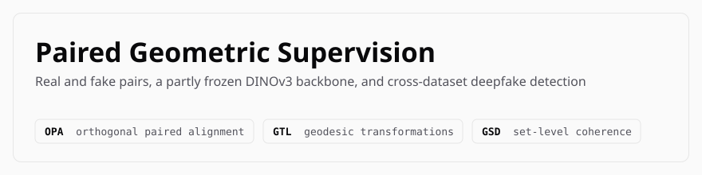

> **Status:** Accepted at BMVC 2026 (poster). Method description corrected after camera-ready; no numbers changed. See `CORRECTIONS.md`.

<picture>
  <source media="(prefers-color-scheme: dark)" srcset="docs/assets/hero-dark.svg">
  
</picture>

This repository holds the tables, figures, evidence and released models behind *Paired Geometric Supervision for Generalizable Deepfake Detection*, by Luke Collins, Chang-Tsun Li, Duc Thanh Nguyen and Victor Sanchez (Deakin University and the University of Warwick).

The method trains a partly frozen DINOv3 ViT-L/16 on pairs of a real frame and its manipulated counterpart. Orthogonal pair alignment (OPA) splits each pair into a manipulation direction and an identity-preserving residual. Geodesic transformation learning (GTL) separates real-to-fake trajectories from real-to-real variation. Set-geometric descriptor regularisation (GSD) asks for consistency within a video. Three configurations are reported, each at three seeds: LayerNorm tuning (LN), LoRA, and LoRA with GSD (GSD-LoRA). On 17 unseen datasets under one preprocessing pipeline, GSD-LoRA scores 92.82 MEAN-17 Video-AUC against 91.58 for the strongest of six re-evaluated baselines. The LN configuration is not significantly better than that baseline, and GSD adds only 0.20 over plain LoRA, within seed variation.

The paper describes a paired SLERP augmentation that was inactive in every run. The text has been corrected to match what trained; the numbers have not changed. `CORRECTIONS.md` records the change, and `results/slerp_rerun/` holds a matched rerun with the interpolation restored.

## What is here

| Path | What it holds | Paper section |
|---|---|---|
| `src/` | The scripts that regenerate tables and figures, and the tests that check them against the printed numbers. | 4, supplementary |
| `results/` | Run logs for the nine headline runs and the ablations, the baseline re-evaluation, published numbers, ArcFace artefacts, training-dynamics curves and the SLERP rerun. `results/README.md` describes each folder. | 4, supplementary |
| `configs/` | The configuration of every run: three headline configurations at three seeds, the component ablations and the sweeps. | 4, supplementary |
| `checkpoints/` | One JSON sidecar per released model: source file, base-weight revision, key layout, tensor counts, resolved configuration and sha256. | 4 |
| `data/` | Download target for the release assets. Nothing in it is tracked except its README. | supplementary |
| `method/` | The method code as it was when the headline models were trained, read-only. `method/METHOD.md` says which commit, what is included and what differs in the ablation runs. | 3 |
| `patches/` | `slerp-restore.patch`, which restores the paired SLERP step on top of the method code. | 3 |
| `figures/` | The paper's figures as PDF and PNG. | 1 to 4, supplementary |
| `pdfs/` | The corrected paper and supplementary. | all |
| `MANIFEST.md` | Every table and figure mapped to its script, artefact and reproduction status. | all |
| `CHECKPOINTS.md` | The model card: files, sizes, hashes, URLs and how to reassemble a model. | 4 |
| `CORRECTIONS.md` | What changed after camera-ready, and why. | 3 |

## Quick start

```bash
git clone https://github.com/lukegcollins/BMVC26-PGS && cd BMVC26-PGS
uv sync
uv run pytest
uv run python src/tables/table4_wilcoxon.py
```

The last command prints Table 4 from `results/baselines/comparison_master.csv` and needs no other input. Every command in `MANIFEST.md` is run from the repository root.

## Headline results

| Claim | Value | Where |
|---|---|---|
| LN against GenD-DINO (91.58) | MEAN-17 91.97, +0.39, p 0.43, 11 of 17 datasets; not significant | Table 4; `src/tables/table4_wilcoxon.py` |
| LoRA against GenD-DINO | MEAN-17 92.62, +1.04, p 0.020, 13 of 17 datasets | Table 4 |
| GSD-LoRA against GenD-DINO | MEAN-17 92.82, +1.24, p 0.015, 13 of 17 datasets | Table 4 |
| GSD over plain LoRA | +0.20 MEAN-17, p 0.40; within seed variation | Table 6; `src/tables/reproduce_tables.py ablations` |

The p-values are exact two-sided Wilcoxon signed-rank tests over the 17 datasets. For the GSD-over-LoRA row, the same test is run with plain LoRA as the reference.

## Reproducing

Listed per paper element in `MANIFEST.md`, in three groups.

- **From shipped inputs.** Tables 2 to 6, S2, S3, S5, S6 and S11 to S16, and Figures 2, S1 to S4 and S6. The Ours cells come from the run logs in `results/logs/` through `src/tables/reproduce_tables.py`. The baseline cells come from `results/baselines/comparison_master.csv` through `src/tables/emit_paper_tables.py` and `src/tables/emit_supplementary_tables.py`. Those emitters also write Ours rows, computed from `comparison_master.csv`, which averages per-seed values rounded to two decimal places for some columns; five Ours cells print 0.01 away from the paper there. The paper's values are the log-derived ones. Three cells sit exactly on a half (Table 2 GenD-CLIP MEAN; Table S3 FA (ours) MEAN and MEAN delta): the paper rounds half up and the emitters print with Python rounding, so they show the other neighbour. The tests compare the underlying values.
- **With release assets.** Tables S8 and S9 need the two ArcFace arrays from the `v1.0` release (`CHECKPOINTS.md` has the URLs). Without them `src/test_manifest.py` skips those rows with a reason. The "all combinations" mean of cos(z_perp) in Table S8 is the mean over the shipped 10,000-row sample; the full population gives 0.0540.
- **Not regenerated.** Figures 1 and S5 are static images and no generator survives. Tables 1, S1 and S10 are typed in the paper, and Table S4 is typed from `results/published/published_numbers.csv` and `results/baselines/comparison_master.csv`. Table S7 is typed from `results/repr_geometry/repr_geometry_summary.md`; recomputing it needs the extracted DeepSpeak-v2 features, which are not shipped.

Table 5 has a script written for this repository, `src/dynamics/table5.py`, because no original generator survived; its slope rule is in `results/training_dynamics/README.md`.

Training is not repeated here. `method/` holds the code that defined the method, and the logs hold what it produced. The twenty-five ablation runs and ten sweep runs used a later commit of the same codebase; `method/METHOD.md` lists the differences.

About the configurations: `configs/` set `use_paired_slerp_aug: false`, which matches what ran. The run logs and the sidecar configurations of the released checkpoints keep the recorded `true`. The flag had no effect in that code (`method/METHOD.md`, `patches/`, `results/slerp_rerun/`).

## Models

The nine headline models are released as the parts that training changed, in `v1.0` release assets. `CHECKPOINTS.md` lists each file with its epoch, validation AUC, size, sha256 and URL, what was removed, and how to reassemble a model from the files and the base weights.

Running a model on your own video is done by the `deepfake-workbench` adapter (dfwb-research), which is not yet released. Downloads need repository access until the repository is public.

The released files are derivatives of DINOv3 and are distributed under the DINOv3 License (`LICENSE-DINOv3.md`). The base weights come from Hugging Face (`facebook/dinov3-vitl16-pretrain-lvd1689m`, revision `ea8dc2863c51be0a264bab82070e3e8836b02d51`, gated) and are not redistributed here.

## Data

No images or video are distributed. The run logs hold per-checkpoint test results for each evaluation set; the datasets themselves must be obtained from their owners.

Baseline numbers other than our re-evaluation come from four works:

- Cui, Li, Luo, Zhou and Dong, *Forensics Adapter: Adapting CLIP for Generalizable Face Forgery Detection*, CVPR 2025 (`cui2025forensics`).
- Nguyen, Astrid, Kacem, Ghorbel and Aouada, *Vulnerability-Aware Spatio-Temporal Learning for Generalizable Deepfake Video Detection*, ICCV 2025 (`nguyen2025vulnerability`).
- Yan, Wang, Jin, Zhang, Liu, Chen, Yao, Ding, Wu and Yuan, *Orthogonal Subspace Decomposition for Generalizable AI-Generated Image Detection*, ICML 2025 (`yan2025orthogonal`).
- Yermakov, Cech, Matas and Fritz, *Deepfake Detection that Generalizes Across Benchmarks*, WACV 2026 (`yermakov2026deepfake`).

The keys are those in the `source` column of `results/published/published_numbers.csv`, which holds the typed values and the table of each work they come from.

## Cite

`CITATION.cff` carries the metadata.

```bibtex
@inproceedings{collins2026orthopairgtl,
  title     = {Paired Geometric Supervision for Generalizable Deepfake Detection},
  author    = {Collins, Luke and Li, Chang-Tsun and Nguyen, Duc Thanh and Sanchez, Victor},
  booktitle = {Proceedings of the British Machine Vision Conference (BMVC)},
  year      = {2026},
}
```

## Principles

- Numbers are recomputed from the run logs wherever the logs exist, and a regenerated value that disagrees with the paper is reported, not edited away.
- The method code is shown as it ran, without cleaning. The one change that matters, the inactive SLERP step, is a patch beside it.
- Corrections are recorded with their before and after in `CORRECTIONS.md`.
- Seeds and dependency pins are fixed, and the lock file ships.

## Licence

Code and text are MIT (`LICENSE`). The released model files are distributed under the DINOv3 License (`LICENSE-DINOv3.md`).
